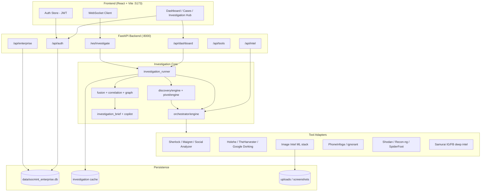

# SOCMINT Intelligence Platform — Architecture & Run Guide

> **Project:** Karnataka CID Hackathon OSINT Platform  
> **Stack:** FastAPI (Python 3.10+) + React/Vite/TypeScript frontend  
> **Purpose:** Production-grade social-media intelligence (SOCMINT) — username/email/phone/domain/image investigations with tool fusion, correlation, graph analysis, enterprise RBAC, and live WebSocket progress.

---

## 1. High-Level Architecture



### Request lifecycle (typical investigation)

1. **User** enters a query (username, email, phone, domain, image URL/path, or combo) in the React dashboard.
2. **WebSocket** (`/ws/investigate`) or REST (`POST /api/dashboard/investigate`) receives the request.
3. **`query_detector`** classifies input type; **`investigation_runner`** acquires a resource slot (one investigation at a time by default).
4. **`ToolOrchestratorEngine`** runs OSINT tools in parallel (capped by `resource_guard` and `parallel_config`).
5. **`RecursiveDiscoveryEngine`** optionally expands via **auto-pivot** (new leads → new tool runs).
6. Results pass through **normalization → fusion → correlation → graph → evidence → linguistic analysis → brief**.
7. Progress events stream back over WebSocket; final JSON stored in memory cache (+ optional PostgreSQL).

---

## 2. Repository Layout

```
hackathon/
├── main.py                    # FastAPI entry point, lifespan warmup, router mount
├── requirements.txt           # Python dependencies (ML-heavy)
├── .env.example               # Environment template — copy to .env
├── yolov8n.pt                 # Bundled YOLO weights for object detection
│
├── api/                       # HTTP + WebSocket routes
│   ├── auth_routes.py         # Login, refresh, password reset
│   ├── dashboard_routes.py    # Investigate, copilot, export, review
│   ├── enterprise_routes.py   # Cases, users, approvals, audit
│   ├── routes.py              # Direct intel endpoints (/api/intel/*)
│   ├── tools_status.py        # Tool health & OSINT registry
│   ├── ws.py                  # Live investigation WebSocket
│   └── deps.py                # JWT auth + RBAC permission deps
│
├── orchestrator/              # Multi-tool execution engine
│   ├── engine.py              # ToolOrchestratorEngine — parallel tool runs
│   ├── config.py              # ADAPTER_MAP, timeouts, feature→tool mapping
│   ├── parallel_config.py     # Concurrency caps, wall-clock budgets
│   └── parallel_runner.py     # Batched parallel execution
│
├── adapters/                  # One adapter per external/builtin OSINT tool
│   ├── base.py                # BaseAdapter — verify, retry, timeout, isolate failures
│   ├── sherlock.py, maigret.py, social_analyzer.py, holehe.py, ...
│   ├── google_dorking.py      # Built-in ddgs web search
│   ├── image_intel.py         # Unified image pipeline adapter
│   ├── image_tools.py         # Per-model adapters (InsightFace, YOLO, OCR, …)
│   ├── phone_social_intel.py  # PhoneInfoga + ignorant + web
│   ├── samurai.py             # Instagram/Facebook deep scraping bridge
│   └── external_osint.py      # Blackbird, Nexfil, GHunt, PhoneInfoga, …
│
├── services/                  # Business logic (173+ modules)
│   ├── investigation_runner.py    # Main investigation pipeline + WS progress
│   ├── query_detector.py          # Auto-detect username/email/phone/domain/image
│   ├── fusion/                      # Merge & dedupe tool outputs
│   ├── correlation/engine.py        # Account clustering & handle quality
│   ├── graph_intelligence/          # NetworkX knowledge graph
│   ├── discovery/engine.py          # Recursive discovery wrapper
│   ├── pivot/                       # Auto-pivot lead queue & tree
│   ├── evidence/engine.py           # Evidence extraction & attribution
│   ├── image_intelligence/          # Face, OCR, metadata, YOLO, CLIP, …
│   ├── reverse_image/               # Reverse image search sources
│   ├── phone_intelligence/          # Phone parsing, PhoneInfoga, social lookup
│   ├── google_dorking/              # Dork query builder + SERP parser
│   ├── linguistic/                  # NLP / sentiment / NER on bios & posts
│   ├── copilot/                     # Ollama Qwen chat over investigation context
│   ├── enterprise/                  # JWT auth, cases, audit, RBAC, approvals
│   ├── osint_registry/              # Dynamic tool catalog from JSON
│   ├── resource_guard.py            # Memory pressure + subprocess caps
│   └── persistence/postgres.py        # Optional PostgreSQL persistence
│
├── schemas/                   # Pydantic request/response models
├── config/                    # JSON configuration
│   ├── tool_registry.json     # Installed tool paths & health
│   ├── osint_catalog.json     # Tool metadata, features, priorities
│   ├── rbac.json              # Role → permission matrix
│   ├── demo_users.json        # Seeded demo accounts per role
│   └── agencies.json
│
├── tools/
│   └── registry.py            # ToolRegistry — health checks, executable resolution
│
├── frontend/                  # React 19 + Vite 8 + Tailwind 4 + Zustand
│   ├── src/
│   │   ├── pages/             # Dashboard, Cases, Investigation Hub, Admin, …
│   │   ├── api/               # REST client wrappers
│   │   ├── store/             # authStore, uiStore
│   │   └── layout/AppShell.tsx
│   └── vite.config.ts         # Dev proxy: /api & /ws → :8000
│
├── scripts/                   # Install, verify, e2e, model download helpers
├── tests/                     # 80+ pytest modules
│
├── external_tools/            # ⚠ Git-cloned OSINT repos (Sherlock, SpiderFoot, …)
├── samurai/                   # ⚠ Instagram/Facebook scraper submodule
├── phoneNumber/               # ⚠ PhoneInfoga config & .env
└── data/                      # SQLite DB, uploads, copilot cache (created at runtime)
```

---

## 3. Layer Responsibilities

| Layer | Role | Key files |
|-------|------|-----------|
| **Presentation** | SPA dashboard, live progress, graph viz (Cytoscape) | `frontend/src/*` |
| **API Gateway** | REST + WS, CORS, auth middleware | `api/*`, `main.py` |
| **Orchestration** | Parallel tool dispatch, timeouts, failure isolation | `orchestrator/*` |
| **Adapters** | Normalize CLI/API tools to `ToolResult` schema | `adapters/*` |
| **Intelligence** | Fusion, correlation, graph, evidence, brief | `services/fusion`, `correlation`, `graph_intelligence`, … |
| **Enterprise** | JWT, cases, audit trail, approvals, RBAC | `services/enterprise/*`, `config/rbac.json` |
| **Registry** | Which tools exist, installed, need API keys | `config/tool_registry.json`, `tools/registry.py` |
| **Resource control** | RAM pressure, subprocess cap, investigation queue | `services/resource_guard.py` |

---

## 4. Supported Investigation Types

| Query type | Example input | Primary tools |
|------------|---------------|---------------|
| **username** | `johndoe` | Sherlock, Maigret, Social Analyzer, Platform Probe, Samurai, Google Dorking |
| **email** | `user@domain.com` | Holehe, TheHarvester, Google Dorking, Gravatar, GHunt |
| **phone** | `+91XXXXXXXXXX` | PhoneInfoga, ignorant, phone social lookup |
| **domain** | `example.com` | TheHarvester, SpiderFoot, Recon-ng, subfinder, amass, dnsrecon |
| **infra** | IP or host | Shodan (requires API key) |
| **image** | URL or upload | InsightFace, DeepFace, YOLO, OCR, reverse image, EXIF |
| **combo** | `username \| email@x.com` | Dual parallel username + email branches |

Query type is auto-detected by `services/query_detector.py` unless overridden in the request.

---

## 5. API Surface

### Public / health
| Method | Path | Description |
|--------|------|-------------|
| GET | `/` | Service info + endpoint index |
| GET | `/health` | Health check |

### Authentication (`/api/auth`)
| Method | Path | Description |
|--------|------|-------------|
| GET | `/api/auth/status` | Whether enterprise auth is enabled |
| POST | `/api/auth/login` | JWT login |
| POST | `/api/auth/refresh` | Refresh access token |
| POST | `/api/auth/logout` | Invalidate session |

### Dashboard (`/api/dashboard`) — requires RBAC
| Method | Path | Description |
|--------|------|-------------|
| POST | `/api/dashboard/investigate` | Start investigation (sync) |
| GET | `/api/dashboard/investigations/{id}` | Fetch result |
| POST | `/api/dashboard/copilot` | AI copilot chat (Ollama) |
| POST | `/api/dashboard/export` | Export investigation report |
| POST | `/api/dashboard/review` | Evidence cluster review |

### Intelligence (`/api/intel`) — requires `start_investigation`
| Method | Path | Description |
|--------|------|-------------|
| POST | `/api/intel/username-search` | Username-only scan |
| POST | `/api/intel/email` | Email intelligence |
| POST | `/api/intel/domain` | Domain recon |
| POST | `/api/intel/infra` | Infrastructure (Shodan) |
| POST | `/api/intel/image` | Image analysis |
| POST | `/api/intel/image/upload` | Upload image file |
| POST | `/api/intel/correlate` | Run correlation on fusion output |
| POST | `/api/intel/graph` | Build knowledge graph |

### WebSocket
| Path | Description |
|------|-------------|
| `/ws/investigate` | Live investigation with progress events + cancel |

**WS payload (send after connect):**
```json
{
  "query": "target_username",
  "query_type": "username",
  "access_token": "<JWT if enterprise auth enabled>",
  "case_id": "<required when enterprise auth enabled>",
  "discovery": { "enabled": true, "max_hops": 2 }
}
```

### Tools
| Method | Path | Description |
|--------|------|-------------|
| GET | `/api/tools/status` | Per-tool install/health status |
| GET | `/api/tools` | OSINT catalog registry |

---

## 6. Enterprise Auth & RBAC

- Controlled by `ENTERPRISE_AUTH=true` in `.env` (default).
- SQLite database: `data/socmint_enterprise.db` (auto-created on startup).
- JWT secret: `JWT_SECRET` (change in production).

### Default admin (seeded on first startup)
| Field | Value |
|-------|-------|
| Username | `admin` |
| Password | `Socmint@CID2026!Admin` |

### Demo users (when `SEED_DEMO_USERS=true`)
Password for all demo roles: `Socmint@Demo2026!` (see `config/demo_users.json`)

Roles: `CID_DIRECTOR`, `SP`, `DSP`, `INSPECTOR`, `SUB_INSPECTOR`, `ANALYST`, `INTELLIGENCE_OFFICER`, `FORENSICS_OFFICER`, `VIEWER`, `AUDITOR`

Permissions defined in `config/rbac.json`. Investigations require a **case_id** when enterprise auth is on.

---

## 7. Configuration Reference

Copy environment template:
```powershell
Copy-Item .env.example .env
```

### Critical variables

| Variable | Default | Purpose |
|----------|---------|---------|
| `ENTERPRISE_AUTH` | `true` | Enable login + RBAC |
| `JWT_SECRET` | (change me) | JWT signing key |
| `CORS_ORIGINS` | `http://localhost:5173,...` | Frontend origins |
| `SHODAN_API_KEY` | empty | Required for infra intel |
| `IG_SESSIONID` | empty | Instagram deep intel (Samurai) |
| `MAX_CONCURRENT_INVESTIGATIONS` | `1` | Investigation queue |
| `GLOBAL_TOOL_SUBPROCESS_CAP` | `6` | Parallel subprocess limit |
| `INVESTIGATION_WALL_SECONDS` | `300` | Max investigation duration |
| `COPILOT_ENABLED` | — | Ollama copilot (`ollama pull qwen2.5:3b`) |

Full reference: see `.env.example`.

---

## 8. Run Guide — Current Environment (Windows)

**Detected on this machine (2026-07-03):**

| Component | Status |
|-----------|--------|
| Python | ✅ 3.10.11 |
| Node.js | ✅ v22.22.0 |
| npm | ✅ 11.7.0 |
| `.env` | ❌ Not created yet |
| Python venv (`.venv`) | ❌ Not created yet |
| `frontend/node_modules` | ❌ Not installed yet |
| `external_tools/` | ❌ Missing (Sherlock, SpiderFoot, etc.) |
| `samurai/` | ❌ Missing (Instagram/Facebook deep intel) |
| `phoneNumber/` | ❌ Missing (PhoneInfoga local config) |
| `data/` | ❌ Created automatically on first run |

> **Note:** Core backend and pip-installed tools (Maigret, Holehe, Shodan SDK) can run without `external_tools/`. Username scans that depend on Sherlock/Social Analyzer and phone/Samurai features will report tools as not installed until those directories are set up.

---

### Step 1 — Backend virtual environment

Open PowerShell in the project root:

```powershell
cd D:\KARNATAKA_CID\hackathon

# Create venv
python -m venv .venv

# Activate (PowerShell)
.\.venv\Scripts\Activate.ps1

# Upgrade pip and install dependencies (may take 15–30+ min — includes torch, paddle, insightface)
pip install --upgrade pip setuptools wheel
pip install -r requirements.txt
```

**Optional — download ML model weights ahead of time:**
```powershell
python scripts\download_image_models.py
python scripts\download_linguistic_models.py
```

---

### Step 2 — Environment file

```powershell
Copy-Item .env.example .env
# Edit .env in your editor — at minimum set JWT_SECRET for production use
# Add SHODAN_API_KEY if you need infra investigations
```

---

### Step 3 — External OSINT tools (optional but recommended)

The project ships a bash installer. On Windows use **Git Bash** or **WSL**:

```bash
cd /d/KARNATAKA_CID/hackathon
bash scripts/install_tools.sh
```

> **Windows note:** A Windows Python venv uses `.venv/Scripts/activate`, not `.venv/bin/activate`.
> The installer detects both layouts automatically. If you previously created `.venv` with PowerShell,
> Git Bash will now activate it correctly.

This creates:
- `.venv` (if not exists)
- `external_tools/sherlock`, `SocialAnalyzer`, `theHarvester`, `spiderfoot`, `recon-ng`, …
- Updates `config/tool_registry.json` install flags

**Manual minimum (PowerShell) for Sherlock example:**
```powershell
mkdir external_tools
git clone --depth 1 https://github.com/sherlock-project/sherlock.git external_tools\sherlock
pip install -e external_tools\sherlock
```

Verify:
```powershell
python -c "from tools.registry import registry; registry.reload(); print({k: registry.check_health(k).value for k in registry.list_tools()})"
```

---

### Step 4 — Start backend

```powershell
cd D:\KARNATAKA_CID\hackathon
.\.venv\Scripts\Activate.ps1

# Development server with hot reload
uvicorn main:app --reload --host 127.0.0.1 --port 8000
```

Verify:
- http://127.0.0.1:8000/health → `{"status":"ok"}`
- http://127.0.0.1:8000/api/tools/status → tool health JSON
- http://127.0.0.1:8000/docs → Swagger UI

**First startup notes:**
- Creates `data/socmint_enterprise.db` and seeds admin + demo users
- Warms ML stacks (TensorFlow, InsightFace) in background — first image run may still download ~275 MB models

---

### Step 5 — Start frontend

New terminal:

```powershell
cd D:\KARNATAKA_CID\hackathon\frontend
npm install
npm run dev
```

Open: **http://localhost:5173**

Vite proxies `/api` and `/ws` to the backend — no `frontend/.env` needed for local dev.

---

### Step 6 — Login & first investigation

1. Login as `admin` / `Socmint@CID2026!Admin`
2. Create a **Case** (required before investigations)
3. Open **Investigation Hub** → enter a username → start scan
4. Watch live progress via WebSocket

**Quick API test (after login token):**
```powershell
Invoke-RestMethod -Uri "http://127.0.0.1:8000/health"
```

---

## 9. Optional Services

| Service | Purpose | Setup |
|---------|---------|-------|
| **Ollama** | Copilot chat | `ollama pull qwen2.5:3b`, set `COPILOT_*` in `.env` |
| **PostgreSQL** | Persistent investigations | `DATABASE_URL` / `ENTERPRISE_DATABASE_URL` |
| **Neo4j** | Graph export | `NEO4J_URI`, `NEO4J_USER`, `NEO4J_PASSWORD` |
| **Playwright** | Page screenshots | `pip install playwright && playwright install chromium` |
| **Tesseract OCR** | System OCR binary | Install Tesseract, add to PATH |
| **SerpAPI** | Google Lens bypass | `SERPAPI_API_KEY` |

---

## 10. Testing

```powershell
cd D:\KARNATAKA_CID\hackathon
.\.venv\Scripts\Activate.ps1
pytest tests/ -q
```

Run a subset:
```powershell
pytest tests/test_engine_integration.py tests/test_enterprise_auth.py -v
```

---

## 11. Key Design Patterns

1. **Adapter pattern** — Every OSINT tool implements `BaseAdapter.run()` → uniform `ToolResult`.
2. **Failure isolation** — One tool crash never kills the investigation; errors captured per tool.
3. **Registry-driven tool selection** — `config/osint_catalog.json` drives which tools run per feature/profile.
4. **Resource guard** — Subprocess semaphore + memory pressure checks prevent laptop OOM.
5. **Progress streaming** — `investigation_runner` emit callbacks → WebSocket JSON events.
6. **Auto-pivot discovery** — New entities (emails, usernames, URLs) enqueue follow-up tool runs.
7. **Enterprise gate** — FastAPI `Depends(require_permission(...))` enforces RBAC on every sensitive route.

---

## 12. Frontend Page Map

| Page key | Component | Purpose |
|----------|-----------|---------|
| `dashboard` | DashboardPage | Overview metrics for investigators |
| `cases` | CasesPage | Case list & creation |
| `case-workspace` | CaseWorkspacePage | Single case detail |
| `investigations` | InvestigationHubPage | Run & view investigations |
| `graph` | InvestigationHubPage | Knowledge graph view |
| `evidence` | InvestigationHubPage | Evidence review |
| `osint-framework` | OsintFrameworkPage | OSINT tool catalog browser |
| `tools` | ToolsPage | Backend tool status |
| `intel-api` | IntelApiPage | Direct API testing UI |
| `admin` | AdminPage | User management |
| `audit` | AuditPage | Audit log viewer |
| `pending-approvals` | PendingApprovalsPage | Evidence approval workflow |

State: **Zustand** (`authStore`, `uiStore`). API clients in `frontend/src/api/`.

---

## 13. Troubleshooting

| Symptom | Likely cause | Fix |
|---------|--------------|-----|
| Tool `NOT_INSTALLED` | Missing `external_tools/` clone | Run `scripts/install_tools.sh` or manual clone |
| 401 on investigate | No JWT / expired session | Re-login; pass `access_token` in WS payload |
| 400 `case_id required` | Enterprise mode | Create & select a case first |
| 429 Investigation busy | `MAX_CONCURRENT_INVESTIGATIONS=1` | Wait for current run to finish or cancel via WS |
| Slow first image run | ML model download | Pre-run `scripts/download_image_models.py` |
| Samurai no IG bio | No session cookie | Set `IG_SESSIONID` in `.env` |
| Infra intel fails | No Shodan key | Set `SHODAN_API_KEY` |
| CORS errors | Wrong origin | Match `CORS_ORIGINS` to frontend URL |
| `Activate.ps1` blocked | Execution policy | `Set-ExecutionPolicy -Scope CurrentUser RemoteSigned` |

---

## 14. Production Checklist

- [ ] Change `JWT_SECRET`, `ADMIN_PASSWORD`
- [ ] Set `SEED_DEMO_USERS=false` in production
- [ ] Configure `SHODAN_API_KEY` and other API keys as needed
- [ ] Build frontend: `cd frontend && npm run build` → serve `dist/` behind reverse proxy
- [ ] Run backend with production ASGI server (gunicorn/uvicorn workers)
- [ ] Point `CORS_ORIGINS` to production frontend URL
- [ ] Optional: PostgreSQL + Neo4j for persistence

---

## 15. Quick Reference — Two-Terminal Dev Session

**Terminal 1 (Backend):**
```powershell
cd D:\KARNATAKA_CID\hackathon
.\.venv\Scripts\Activate.ps1
uvicorn main:app --reload --host 127.0.0.1 --port 8000
```

**Terminal 2 (Frontend):**
```powershell
cd D:\KARNATAKA_CID\hackathon\frontend
npm run dev
```

**URLs:**
- Frontend UI: http://localhost:5173
- API docs: http://127.0.0.1:8000/docs
- Health: http://127.0.0.1:8000/health

---

*Generated from codebase analysis — branch `dev_mahendra`, project root `D:\KARNATAKA_CID\hackathon`.*
